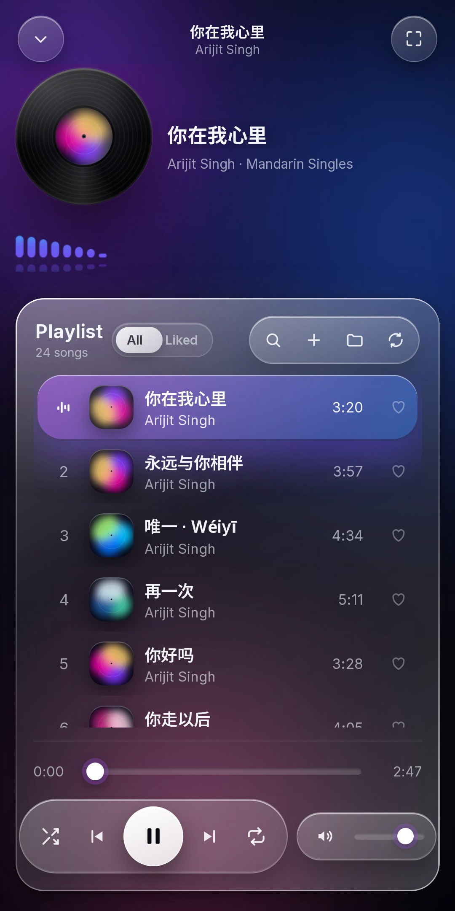
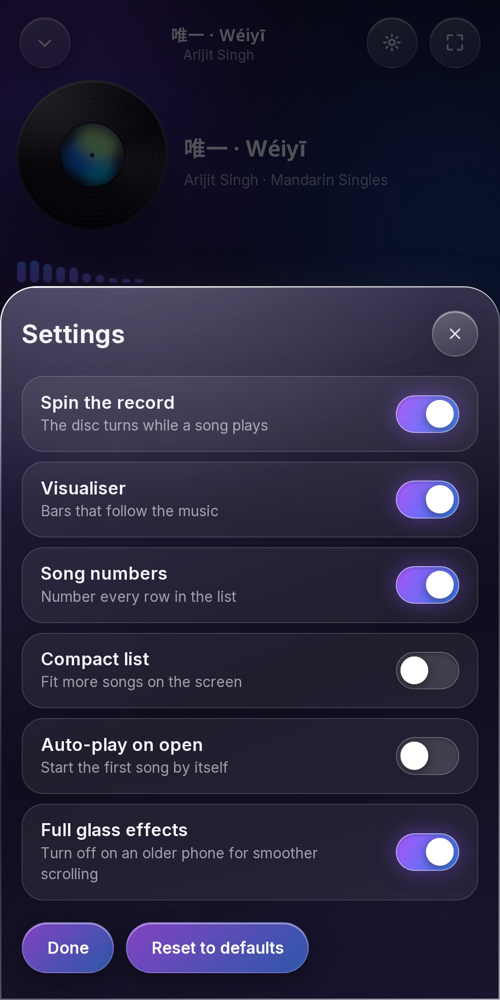
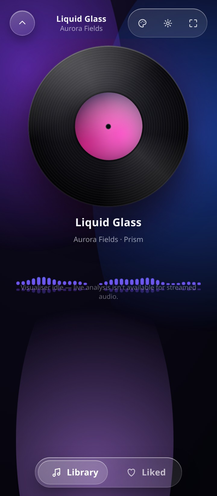

# Vinyl Player

**Current version: 81** · [Changelog](CHANGELOG.md) · every change is committed here as it is made


**By Raju.**

A **liquid-glass music player for Android that plays the songs already on your
phone.** Nothing is bundled, nothing is downloaded, and the app asks for no
network permission at all — it cannot phone home because it has no way to.

<p align="center">
  
  
  
</p>

- **Your library, not ours.** Reads Android's media library and shows the cover
  art embedded in each file.
- **Liquid Glass.** Floating glass capsules, specular rims, a drifting colour
  field, and a highlight that follows your finger.
- **A record that really turns**, driven by real playback state.
- **A visualiser that reacts to your music** — the audio is served same-origin,
  so the analyser can actually read it.
- **Smooth at 120 Hz**, with the per-frame work kept tiny on purpose.
- **Six sliding switches** in Settings: spin, visualiser, numbers, compact rows,
  auto-play, and the glass effects.

---

## Demo

[](https://github.com/technicalnihilist-lgtm/vinyl-player/releases/download/v50.0/vinyl-player-demo.mp4)

A 27-second look at the opening screen and the player: [`https://github.com/technicalnihilist-lgtm/vinyl-player/releases/download/v50.0/vinyl-player-demo.mp4`](https://github.com/technicalnihilist-lgtm/vinyl-player/releases/download/v50.0/vinyl-player-demo.mp4)

## Watch the introduction

A 2:19 introduction to the app and to Liquid Glass:
[`vinyl-player-intro-720p.mp4`](https://github.com/technicalnihilist-lgtm/vinyl-player/releases/download/v50.0/vinyl-player-intro-720p.mp4) · the 27-second demo: [`vinyl-player-demo.mp4`](https://github.com/technicalnihilist-lgtm/vinyl-player/releases/download/v50.0/vinyl-player-demo.mp4)

## The now-playing card

Android has no Dynamic Island — that is an iPhone feature. What Android gives an
app instead is a `MediaSession` and a media notification, and that is what shows
on the lock screen, in the notification shade, in the quick-settings media
player, and in the control centre Xiaomi, Realme and Honor build on top of it.

The page pushes the current song and play state across the bridge; the shell
builds the card and sends the card's buttons back into the player. Android 13 and
up ask for the notification permission the first time something is playing.

## Make it look how you want

Settings has a **Style** panel, so the player does not have to look the way it
ships. Everything in it is saved on the device and applied as CSS custom
properties, so a change re-themes the whole UI at once:

- **Accent** — eight colours, or pick any colour at all, or let the playing
  album's cover choose it for you
- **Background** — seven colour fields: Liquid Glass, Midnight, Sunset, Ocean,
  Forest, Mono, Candy
- **Glass** — a slider for how much frost the panels carry
- **Corners** — a slider from softly squared to fully round
- **Record** — six tints for the disc itself

## Privacy policy

Vinyl Player collects nothing. It is built without the `INTERNET` permission, so it
cannot open a network connection at all. The full policy is at
[docs/privacy.html](docs/privacy.html) — and live at
<https://technicalnihilist-lgtm.github.io/vinyl-player/privacy.html>.

## Publishing to Google Play

The Android build is Play-ready: it targets **API 36** (the level Play requires for
new apps since 31 August 2026) and ships as a signed **App Bundle**.

```bash
cd android
export JAVA_HOME=/path/to/jdk17 ANDROID_HOME=/path/to/android-sdk
export RELEASE_KEYSTORE=/path/to/vinyl-player-upload.jks
export RELEASE_STORE_PASSWORD=… RELEASE_KEY_ALIAS=vinylplayer RELEASE_KEY_PASSWORD=…
bash build.sh                                        # signed APK (sideload)
BUNDLETOOL=/path/to/bundletool-all-1.18.3.jar bash build-aab.sh   # .aab (Play)
```

Play takes the **`.aab`**, not the APK. The listing assets are in `docs/media/`
(the 1024×500 feature graphic) and `store/` (the phone screenshots).

## Download

**Download page:** <https://technicalnihilist-lgtm.github.io/vinyl-player/>
**All builds:** <https://github.com/technicalnihilist-lgtm/vinyl-player/releases/latest>

One player, a build for every platform — and every one of them runs offline.

| Platform | File | How |
|---|---|---|
| **Android** | `vinyl-player.apk` | Open it on the phone, allow "install unknown apps", then allow music access |
| **Windows** | `Vinyl-Player-*-setup.exe` · `*-portable.exe` | Run the installer, or run the portable `.exe` as-is |
| **macOS** | `Vinyl-Player-*.dmg` | Drag to Applications (Intel + Apple silicon) |
| **Linux** | `Vinyl-Player-*.AppImage` | `chmod +x` it and run |
| **iPhone / iPad** | — | Open the download page in Safari → Share → **Add to Home Screen** |
| **Any browser** | — | The download page installs as an app: own window, Start menu entry, offline |

Per-platform notes, including what each OS will ask you about unsigned builds,
are in **[docs/PLATFORMS.md](docs/PLATFORMS.md)**.

### Installing

1. Download `vinyl-player.apk` on your Android device.
2. Android will ask once — allow **"install unknown apps"** for your browser or
   file manager.
3. Open it and allow **music access** when asked. Your songs appear.

Requires **Android 5.0 (API 21) or newer**. Version 50.0, under 1 MB.

---

## What is in this repository

```
web/        the player itself — React + TypeScript + Vite, and an installable PWA
android/    the Android shell — a WebView, a MediaStore bridge, no Gradle
desktop/    the Electron shell for Windows, macOS and Linux
docs/       the download website (published with GitHub Pages)
store/      screenshots for the Google Play listing (1080 x 2160)
.github/    the workflow that builds every platform and publishes the site
```

The interface is written **once**, in `web/`. Android, Windows, macOS and Linux
all run that same build — so the player looks and behaves identically everywhere,
and there is no second UI to keep in sync.

### How the Android app works

The UI is the web app, served from a private `https://` origin
(`appassets.androidplatform.net`) that the app intercepts and answers from its
own assets. Your music reaches that UI two ways:

1. a JavaScript bridge (`window.AndroidBridge`) that reports the MediaStore
   contents as JSON, and
2. two intercepted routes — `/audio/<id>` and `/art/<id>` — that stream the song
   and its embedded cover art back **from the same origin**.

Serving the media from our own origin (rather than `content://`) keeps it
same-origin with the page, which is what lets the Web Audio analyser read it.

No music ships with the app. The APK contains only the UI.

---

## Build it yourself

### The web app

```bash
cd web
npm install
npm run build      # type-checks, then builds to web/dist
npm test           # unit tests
```

### The APK

Needs a **JDK 17** and an **Android SDK** with `platforms;android-34` and
`build-tools;34.0.0`. No Gradle, no Android Studio.

```bash
cd web && npm install && npm run build && cd ..
cd android
ANDROID_HOME=/path/to/android-sdk JAVA_HOME=/path/to/jdk-17 bash build.sh
# -> android/build/vinyl-player.apk
```

`build.sh` finds the build-tools itself, so the only things it needs are
`ANDROID_HOME` and a JDK on the path.

### Regenerating the icon or the screenshots

```bash
python3 android/gen_icons.py     # the launcher icon (needs numpy + pillow)
```

---

## Publishing this on GitHub

### 1. Put the code on GitHub

Create an empty **public** repository called `vinyl-player` at
<https://github.com/new> — do **not** let GitHub add a README, .gitignore or
licence, this repo already has them.

Then, from this folder:

```bash
git init
git add .
git commit -m "Vinyl Player 50.0"
git branch -M main
git remote add origin https://github.com/YOUR-USERNAME/vinyl-player.git
git push -u origin main
```

(Prefer the browser? On the empty repo page choose **uploading an existing
file**, drag everything in, and commit. The command line is easier with this
many files.)

### 2. Turn on the download website (GitHub Pages)

In the repository: **Settings → Pages**.

- **Source: Deploy from a branch**
- **Branch: `main`**, folder **`/docs`**
- **Save**

Wait a minute and your download page is live at:

```
https://YOUR-USERNAME.github.io/vinyl-player/
```

The APK is served straight from the repo at
`/vinyl-player/download/vinyl-player.apk`, so the Download button works with no
extra setup.

> **Or let the workflow do it.** Set **Source: GitHub Actions** instead. The
> included workflow builds the web app *and* the APK from source on every push
> to `main`, drops the fresh APK into the site, and deploys it. That way the
> published APK always matches the code.

### 3. Publish a release with the APK attached

```bash
git tag v43.0
git push origin v43.0
```

The workflow builds the APK and attaches it to a new **Release**, so people can
download it from `https://github.com/YOUR-USERNAME/vinyl-player/releases`.

### 4. (Optional) Put it on Google Play

The APK in this repo is signed with a **throwaway debug key** — perfect for
sideloading, not accepted by Play. For the store you need your own upload key:

```bash
keytool -genkeypair -v -keystore upload.jks -alias upload \
        -keyalg RSA -keysize 2048 -validity 10000
```

Then either sign the built APK:

```bash
$ANDROID_HOME/build-tools/34.0.0/apksigner sign \
  --ks upload.jks --out vinyl-player-release.apk android/build/vinyl-player.apk
```

or, more usually, upload an **Android App Bundle** to Play and let Google sign
it. Play also wants the screenshots from `store/` — they are already the right
size (1080 × 2160, a 2:1 frame, which is the tallest Play accepts).

---

## Permissions

| Permission | Why |
|---|---|
| `READ_MEDIA_AUDIO` (Android 13+) | read the device's music library |
| `READ_EXTERNAL_STORAGE` (maxSdk 32) | the same, on older releases |

There is deliberately **no `INTERNET` permission** — the app cannot reach the
network even if it wanted to. The WebView is also locked to the app's own
bundled content; every other navigation is refused.

---

## Notes and limitations

- Only files Android's media scanner has indexed are listed. If a song is
  missing, make sure it is in a normal Music folder and has been scanned.
- The APK is built and structurally verified (signature schemes v1/v2/v3, dex
  magic, manifest permissions, bundled UI, no bundled audio) and the web layer
  is covered by an automated browser suite, but it has not been run on a
  physical device by the author.
- Screenshots in `store/` were captured against a simulated device library.

## Licence

MIT — see [LICENSE](LICENSE).
