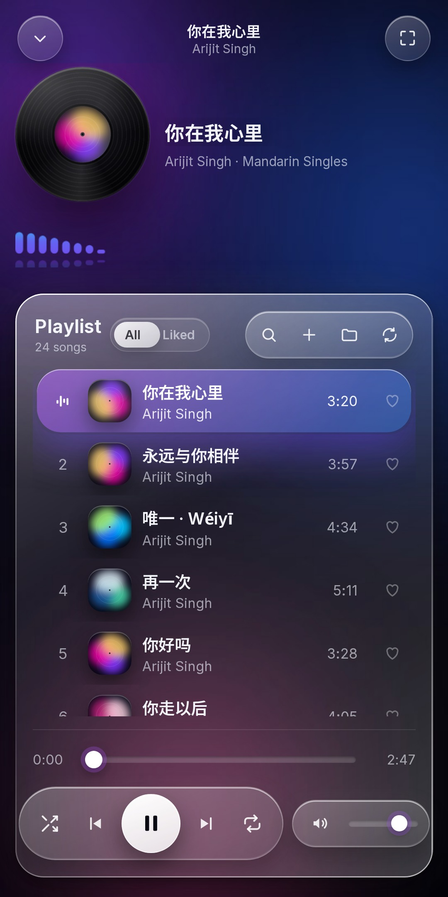
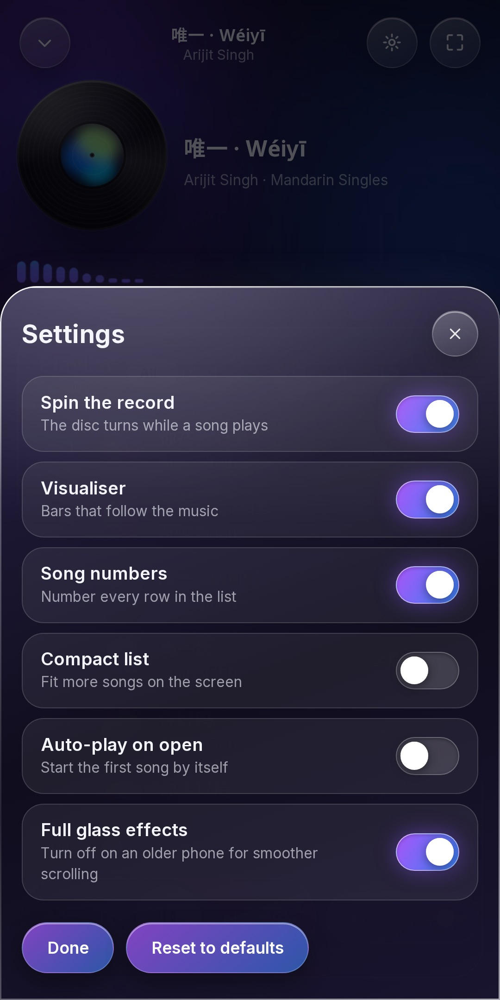
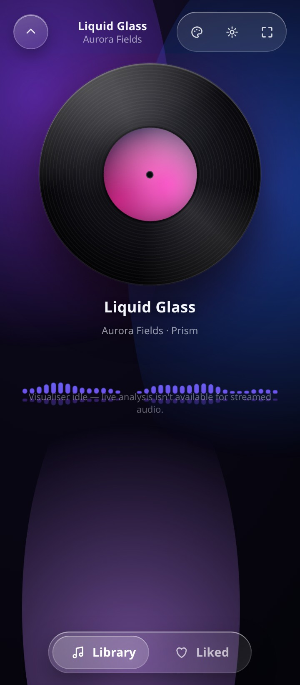

# Vinyl Player

**Current version: 82** · [Changelog](CHANGELOG.md) · every change is committed here as it is made


**By Raju.**

A **liquid-glass music player for Android that plays the songs already on your
phone.** Nothing is bundled, nothing is downloaded, and the app asks for no
network permission at all — it cannot phone home because it has no way to.

<p align="center">
  
  
  
</p>

- **Your library, not ours.** Reads Android's media library and shows the cover
  art embedded in each file.
- **Liquid Glass.** Floating glass capsules, specular rims, a drifting colour
  field, and a highlight that follows your finger.
- **A record that really turns**, driven by real playback state.
- **A visualiser that reacts to your music** — the audio is served same-origin,
  so the analyser can actually read it.
- **Smooth at 120 Hz**, with the per-frame work kept tiny on purpose.
- **Six sliding switches** in Settings: spin, visualiser, numbers, compact rows,
  auto-play, and the glass effects.

---

## Demo

[](https://github.com/technicalnihilist-lgtm/vinyl-player/releases/download/v50.0/vinyl-player-demo.mp4)

A 27-second look at the opening screen and the player: [`https://github.com/technicalnihilist-lgtm/vinyl-player/releases/download/v50.0/vinyl-player-demo.mp4`](https://github.com/technicalnihilist-lgtm/vinyl-player/releases/download/v50.0/vinyl-player-demo.mp4)

## Watch the introduction

A 2:19 introduction to the app and to Liquid Glass:
[`vinyl-player-intro-720p.mp4`](https://github.com/technicalnihilist-lgtm/vinyl-player/releases/download/v50.0/vinyl-player-intro-720p.mp4) · the 27-second demo: [`vinyl-player-demo.mp4`](https://github.com/technicalnihilist-lgtm/vinyl-player/releases/download/v50.0/vinyl-player-demo.mp4)

## The now-playing card

Android has no Dynamic Island — that is an iPhone feature. What Android gives an
app instead is a `MediaSession` and a media notification, and that is what shows
on the lock screen, in the notification shade, in the quick-settings media
player, and in the control centre Xiaomi, Realme and Honor build on top of it.

The page pushes the current song and play state across the bridge; the shell
builds the card and sends the card's buttons back into the player. Android 13 and
up ask for the notification permission the first time something is playing.

## Make it look how you want

Settings has a **Style** panel, so the player does not have to look the way it
ships. Everything in it is saved on the device and applied as CSS custom
properties, so a change re-themes the whole UI at once:

- **Accent** — eight colours, or pick any colour at all, or let the playing
  album's cover choose it for you
- **Background** — seven colour fields: Liquid Glass, Midnight, Sunset, Ocean,
  Forest, Mono, Candy
- **Glass** — a slider for how much frost the panels carry
- **Corners** — a slider from softly squared to fully round
- **Record** — six tints for the disc itself

## Privacy policy

Vinyl Player collects nothing. It is built without the `INTERNET` permission, so it
cannot open a network connection at all. The full policy is at
[docs/privacy.html](docs/privacy.html) — and live at
<https://technicalnihilist-lgtm.github.io/vinyl-player/privacy.html>.

## Publishing to Google Play

The Android build is Play-ready: it targets **API 36** (the level Play requires for
new apps since 31 August 2026) and ships as a signed **App Bundle**.

```bash
cd android
export JAVA_HOME=/path/to/jdk17 ANDROID_HOME=/path/to/android-sdk
export RELEASE_KEYSTORE=/path/to/vinyl-player-upload.jks
export RELEASE_STORE_PASSWORD=… RELEASE_KEY_ALIAS=vinylplayer RELEASE_KEY_PASSWORD=…
bash build.sh                                        # signed APK (sideload)
BUNDLETOOL=/path/to/bundletool-all-1.18.3.jar bash build-aab.sh   # .aab (Play)
```

Play takes the **`.aab`**, not the APK. The listing assets are in `docs/media/`
(the 1024×500 feature graphic) and `store/` (the phone screenshots).

## Download

**Download page:** <https://technicalnihilist-lgtm.github.io/vinyl-player/>
**All builds:** <https://github.com/technicalnihilist-lgtm/vinyl-player/releases/latest>

One player, a build for every platform — and every one of them runs offline.

| Platform | File | How |
|---|---|---|
| **Android** | `vinyl-player.apk` | Open it on the phone, allow "install unknown apps", then allow music access |
| **Windows** | `Vinyl-Player-*-setup.exe` · `*-portable.exe` | Run the installer, or run the portable `.exe` as-is |
| **macOS** | `Vinyl-Player-*.dmg` | Drag to Applications (Intel + Apple silicon) |
| **Linux** | `Vinyl-Player-*.AppImage` | `chmod +x` it and run |
| **iPhone / iPad** | — | Open the download page in Safari → Share → **Add to Home Screen** |
| **Any browser** | — | The download page installs as an app: own window, Start menu entry, offline |

Per-platform notes, including what each OS will ask you about unsigned builds,
are in **[docs/PLATFORMS.md](docs/PLATFORMS.md)**.

### Installing

1. Download `vinyl-player.apk` on your Android device.
2. Android will ask once — allow **"install unknown apps"** for your browser or
   file manager.
3. Open it and allow **music access** when asked. Your songs appear.

Requires **Android 5.0 (API 21) or newer**. Version 50.0, under 1 MB.

---

## What is in this repository

```
web/        the player itself — React + TypeScript + Vite, and an installable PWA
android/    the Android shell — a WebView, a MediaStore bridge, no Gradle
desktop/    the Electron shell for Windows, macOS and Linux
docs/       the download website (published with GitHub Pages)
store/      screenshots for the Google Play listing (1080 x 2160)
.github/    the workflow that builds every platform and publishes the site
```

The interface is written **once**, in `web/`. Android, Windows, macOS and Linux
all run that same build — so the player looks and behaves identically everywhere,
and there is no second UI to keep in sync.

### How the Android app works

The UI is the web app, served from a private `https://` origin
(`appassets.androidplatform.net`) that the app intercepts and answers from its
own assets. Your music reaches that UI two ways:

1. a JavaScript bridge (`window.AndroidBridge`) that reports the MediaStore
   contents as JSON, and
2. two intercepted routes — `/audio/<id>` and `/art/<id>` — that stream the song
   and its embedded cover art back **from the same origin**.

Serving the media from our own origin (rather than `content://`) keeps it
same-origin with the page, which is what lets the Web Audio analyser read it.

No music ships with the app. The APK contains only the UI.

---

## Build it yourself

### The web app

```bash
cd web
npm install
npm run build      # type-checks, then builds to web/dist
npm test           # unit tests
```

### The APK

Needs a **JDK 17** and an **Android SDK** with `platforms;android-34` and
`build-tools;34.0.0`. No Gradle, no Android Studio.

```bash
cd web && npm install && npm run build && cd ..
cd android
ANDROID_HOME=/path/to/android-sdk JAVA_HOME=/path/to/jdk-17 bash build.sh
# -> android/build/vinyl-player.apk
```

`build.sh` finds the build-tools itself, so the only things it needs are
`ANDROID_HOME` and a JDK on the path.

### Regenerating the icon or the screenshots

```bash
python3 android/gen_icons.py     # the launcher icon (needs numpy + pillow)
```

---

## Publishing this on GitHub

### 1. Put the code on GitHub

Create an empty **public** repository called `vinyl-player` at
<https://github.com/new> — do **not** let GitHub add a README, .gitignore or
licence, this repo already has them.

Then, from this folder:

```bash
git init
git add .
git commit -m "Vinyl Player 50.0"
git branch -M main
git remote add origin https://github.com/YOUR-USERNAME/vinyl-player.git
git push -u origin main
```

(Prefer the browser? On the empty repo page choose **uploading an existing
file**, drag everything in, and commit. The command line is easier with this
many files.)

### 2. Turn on the download website (GitHub Pages)

In the repository: **Settings → Pages**.

- **Source: Deploy from a branch**
- **Branch: `main`**, folder **`/docs`**
- **Save**

Wait a minute and your download page is live at:

```
https://YOUR-USERNAME.github.io/vinyl-player/
```

The APK is served straight from the repo at
`/vinyl-player/download/vinyl-player.apk`, so the Download button works with no
extra setup.

> **Or let the workflow do it.** Set **Source: GitHub Actions** instead. The
> included workflow builds the web app *and* the APK from source on every push
> to `main`, drops the fresh APK into the site, and deploys it. That way the
> published APK always matches the code.

### 3. Publish a release with the APK attached

```bash
git tag v43.0
git push origin v43.0
```

The workflow builds the APK and attaches it to a new **Release**, so people can
download it from `https://github.com/YOUR-USERNAME/vinyl-player/releases`.

### 4. (Optional) Put it on Google Play

The APK in this repo is signed with a **throwaway debug key** — perfect for
sideloading, not accepted by Play. For the store you need your own upload key:

```bash
keytool -genkeypair -v -keystore upload.jks -alias upload \
        -keyalg RSA -keysize 2048 -validity 10000
```

Then either sign the built APK:

```bash
$ANDROID_HOME/build-tools/34.0.0/apksigner sign \
  --ks upload.jks --out vinyl-player-release.apk android/build/vinyl-player.apk
```

or, more usually, upload an **Android App Bundle** to Play and let Google sign
it. Play also wants the screenshots from `store/` — they are already the right
size (1080 × 2160, a 2:1 frame, which is the tallest Play accepts).

---

## Permissions

| Permission | Why |
|---|---|
| `READ_MEDIA_AUDIO` (Android 13+) | read the device's music library |
| `READ_EXTERNAL_STORAGE` (maxSdk 32) | the same, on older releases |

There is deliberately **no `INTERNET` permission** — the app cannot reach the
network even if it wanted to. The WebView is also locked to the app's own
bundled content; every other navigation is refused.

---

## Notes and limitations

- Only files Android's media scanner has indexed are listed. If a song is
  missing, make sure it is in a normal Music folder and has been scanned.
- The APK is built and structurally verified (signature schemes v1/v2/v3, dex
  magic, manifest permissions, bundled UI, no bundled audio) and the web layer
  is covered by an automated browser suite, but it has not been run on a
  physical device by the author.
- Screenshots in `store/` were captured against a simulated device library.

## Licence

MIT — see [LICENSE](LICENSE).

---

## ⭐ Like this work? Give it a star

If you like this app and our work, please **star this repository** ⭐ and **[follow technicalnihilist-lgtm on GitHub](https://github.com/technicalnihilist-lgtm)**. If our work isn't for you, that's completely fine — the choice is yours. Thank you for stopping by!

<details>
<summary><b>🌍 Same message in 32 languages (A–Z + Indian languages)</b></summary>

- **A — Arabic** (العربية): ⭐ إذا أعجبك هذا التطبيق وعملنا، فيرجى منح المستودع نجمة ومتابعتنا. وإذا لم يعجبك عملنا، فلا مشكلة على الإطلاق — القرار قرارك. شكرًا لزيارتك!
- **B — Bengali** (বাংলা): ⭐ যদি আপনার এই অ্যাপ এবং আমাদের কাজ ভালো লাগে, তবে অনুগ্রহ করে রিপোজিটরিটিকে একটি স্টার দিন এবং আমাদের ফলো করুন। আমাদের কাজ যদি আপনার পছন্দ না হয়, তাতেও কোনো সমস্যা নেই — সিদ্ধান্ত আপনার। আমাদের পেজে আসার জন্য ধন্যবাদ!
- **C — Chinese** (中文): ⭐ 如果你喜欢这个应用和我们的作品，请给仓库点个星标并关注我们。如果我们的作品不适合你，也完全没关系——选择权在你。感谢你的到访！
- **D — Dutch** (Nederlands): ⭐ Vind je deze app en ons werk leuk? Geef de repository dan een ster en volg ons. Vind je ons werk niets, dan is dat helemaal prima — de keuze is aan jou. Bedankt voor je bezoek!
- **E — English** (English): ⭐ If you like this app and our work, please give the repository a star and follow us. If our work isn't for you, that's completely fine — the choice is yours. Thank you for stopping by!
- **F — French** (Français): ⭐ Si cette application et notre travail vous plaisent, mettez une étoile au dépôt et suivez-nous. Si notre travail n'est pas pour vous, aucun souci — c'est votre choix. Merci de votre visite !
- **G — German** (Deutsch): ⭐ Wenn dir diese App und unsere Arbeit gefallen, gib dem Repository einen Stern und folge uns. Wenn unsere Arbeit nichts für dich ist, ist das völlig in Ordnung — die Wahl liegt bei dir. Danke fürs Vorbeischauen!
- **H — Hindi** (हिन्दी): ⭐ अगर आपको यह ऐप और हमारा काम पसंद है, तो कृपया रिपॉजिटरी को स्टार दें और हमें फॉलो करें। अगर हमारा काम आपके लिए नहीं है, तो भी कोई बात नहीं — यह पूरी तरह आपकी मर्ज़ी है। यहाँ आने के लिए आपका धन्यवाद!
- **I — Indonesian** (Bahasa Indonesia): ⭐ Jika kamu suka aplikasi ini dan karya kami, beri bintang pada repositori ini dan ikuti kami. Kalau karya kami bukan untukmu, tidak masalah sama sekali — itu pilihanmu. Terima kasih sudah mampir!
- **J — Japanese** (日本語): ⭐ このアプリと私たちの仕事が気に入ったら、リポジトリにスターを付けてフォローしてください。合わない場合はまったく問題ありません — 選ぶのはあなたです。お越しいただきありがとうございます！
- **K — Korean** (한국어): ⭐ 이 앱과 저희 작업이 마음에 드신다면 저장소에 스타를 눌러 주시고 팔로우해 주세요. 저희 작업이 맞지 않으셔도 전혀 괜찮습니다 — 선택은 여러분의 몫입니다. 방문해 주셔서 감사합니다!
- **L — Lithuanian** (Lietuvių): ⭐ Jei tau patinka ši programa ir mūsų darbas, duok saugyklai žvaigždutę ir sek mus. Jei mūsų darbas ne tau, viskas gerai — pasirinkimas tavo. Ačiū, kad užsukai!
- **M — Malayalam** (മലയാളം): ⭐ നിങ്ങൾക്ക് ഈ ആപ്പും ഞങ്ങളുടെ പ്രവർത്തനവും ഇഷ്ടപ്പെട്ടെങ്കിൽ, ദയവായി റെപ്പോസിറ്ററിക്ക് ഒരു സ്റ്റാർ നൽകുകയും ഞങ്ങളെ ഫോളോ ചെയ്യുകയും ചെയ്യുക. ഞങ്ങളുടെ പ്രവർത്തനം നിങ്ങൾക്ക് അനുയോജ്യമല്ലെങ്കിൽ, അതും തികച്ചും കുഴപ്പമില്ല — തീരുമാനം നിങ്ങളുടേതാണ്. ഇവിടെ വന്നതിന് നന്ദി!
- **N — Nepali** (नेपाली): ⭐ यदि तपाईंलाई यो एप र हाम्रो काम मन पर्‍यो भने, कृपया रिपोजिटरीलाई स्टार दिनुहोस् र हामीलाई फलो गर्नुहोस्। यदि हाम्रो काम तपाईंलाई मन पर्दैन भने, पनि ठीकै छ — यो तपाईंको इच्छा हो। यहाँ आउनुभएकोमा धन्यवाद!
- **O — Odia** (ଓଡ଼ିଆ): ⭐ ଯଦି ଆପଣଙ୍କୁ ଏହି ଆପ୍ ଏବଂ ଆମର କାମ ଭଲ ଲାଗୁଛି, ତେବେ ଦୟାକରି ରିପୋଜିଟୋରୀକୁ ଗୋଟିଏ ଷ୍ଟାର୍ ଦିଅନ୍ତୁ ଏବଂ ଆମକୁ ଫଲୋ କରନ୍ତୁ। ଯଦି ଆମର କାମ ଆପଣଙ୍କ ପାଇଁ ନୁହେଁ, ତେବେ କିଛି ଅସୁବିଧା ନାହିଁ — ପସନ୍ଦ ଆପଣଙ୍କର। ଆମ ପାଖକୁ ଆସିଥିବାରୁ ଧନ୍ୟବାଦ!
- **P — Polish** (Polski): ⭐ Jeśli podoba Ci się ta aplikacja i nasza praca, daj repozytorium gwiazdkę i obserwuj nas. Jeśli nasza praca nie jest dla Ciebie, to zupełnie w porządku — wybór należy do Ciebie. Dziękujemy za odwiedziny!
- **Q — Quechua** (Runa Simi): ⭐ Kay app, ñuqaykup ruwasqanchikpas gustasunki chayqa, repositorioman huk estrella churay, ñuqaykutapas qatipayku. Mana gustasunki chayqa, allinmi — qampa akllayki. Hamusqaykimanta sulpayki!
- **R — Russian** (Русский): ⭐ Если вам нравится это приложение и наша работа, поставьте звёздочку репозиторию и подпишитесь на нас. Если наша работа не для вас — это совершенно нормально, выбор за вами. Спасибо, что заглянули!
- **S — Spanish** (Español): ⭐ Si te gusta esta app y nuestro trabajo, dale una estrella al repositorio y síguenos. Si nuestro trabajo no es para ti, no pasa nada — la decisión es tuya. ¡Gracias por pasarte!
- **T — Tamil** (தமிழ்): ⭐ உங்களுக்கு இந்த ஆப்பும் எங்க வேலையும் பிடிச்சிருந்தா, தயவுசெஞ்சு இந்த ரெபாசிட்டரிக்கு ஒரு ஸ்டார் குடுத்து, எங்களை ஃபாலோ பண்ணுங்க. எங்க வேலை உங்களுக்கு செட் ஆகலைன்னாலும் பரவாயில்லை — அது உங்க விருப்பம். இங்கே வந்ததுக்கு நன்றி!
- **U — Urdu** (اردو): ⭐ اگر آپ کو یہ ایپ اور ہمارا کام پسند آئے تو براہ کرم ریپازٹری کو سٹار دیں اور ہمیں فالو کریں۔ اگر ہمارا کام آپ کے لیے نہیں ہے، تو یہ بالکل ٹھیک ہے — انتخاب آپ کا ہے۔ یہاں تشریف لانے کا شکریہ!
- **V — Vietnamese** (Tiếng Việt): ⭐ Nếu bạn thích ứng dụng này và công việc của chúng tôi, hãy tặng kho lưu trữ một ngôi sao và theo dõi chúng tôi. Nếu công việc của chúng tôi không phù hợp với bạn, điều đó hoàn toàn ổn — lựa chọn là của bạn. Cảm ơn bạn đã ghé qua!
- **W — Welsh** (Cymraeg): ⭐ Os ydych chi'n hoffi'r ap hwn a'n gwaith, rhowch seren i'r storfa a dilynwch ni. Os nad yw ein gwaith ar eich cyfer, mae hynny'n hollol iawn — chi sydd i benderfynu. Diolch am alw heibio!
- **X — Xhosa** (isiXhosa): ⭐ Ukuba uyayithanda le app nomsebenzi wethu, nika irepo inkwenkwezi kwaye usilandele. Ukuba umsebenzi wethu awukufanelanga, akukho ngxaki — lukhetho lwakho. Enkosi ngokutyelela!
- **Y — Yoruba** (Yorùbá): ⭐ Bí app yìí àti iṣẹ́ wa bá wù ọ́, jọ̀wọ́ fún àkójọpọ̀ náà ní ìràwọ̀ kí o sì tẹ̀lé wa. Bí iṣẹ́ wa kò bá yẹ ọ́, kò séwu — ìwọ ni ó yàn. Ẹ ṣé fún wíwá!
- **Z — Zulu** (isiZulu): ⭐ Uma uthanda le app nomsebenzi wethu, nikeza isitoreji inkanyezi bese usilandela. Uma umsebenzi wethu ungakufanele, akunankinga — wukukhetha kwakho. Siyabonga ngokuvakasha!

**More Indian languages**

- **Assamese** (অসমীয়া): ⭐ যদি আপুনি এই এপটো আৰু আমাৰ কাম ভাল পায়, তেন্তে অনুগ্ৰহ কৰি ৰিপজিটৰীটোক এটা ষ্টাৰ দিয়ক আৰু আমাক ফ'ল' কৰক। যদি আমাৰ কাম আপোনাৰ বাবে নহয়, তেন্তে সেয়া একেবাৰে ঠিক আছে — সিদ্ধান্তটো আপোনাৰ। আমাৰ ইয়ালৈ অহাৰ বাবে ধন্যবাদ!
- **Gujarati** (ગુજરાતી): ⭐ જો તમને આ એપ અને અમારું કામ ગમતું હોય, તો પ્લીઝ રિપોઝિટરીને સ્ટાર આપો અને અમને ફોલો કરો. જો અમારું કામ તમને ન ગમતું હોય, તો તે પણ બરાબર છે — પસંદગી તમારી છે. અહીં આવવા બદલ આભાર!
- **Kannada** (ಕನ್ನಡ): ⭐ ನಿಮಗೆ ಈ ಆ್ಯಪ್ ಮತ್ತು ನಮ್ಮ ಕೆಲಸ ಇಷ್ಟವಾದರೆ, ದಯವಿಟ್ಟು ರೆಪೊಸಿಟರಿಗೆ ಸ್ಟಾರ್ ಕೊಡಿ ಮತ್ತು ನಮ್ಮನ್ನು ಫಾಲೋ ಮಾಡಿ. ನಮ್ಮ ಕೆಲಸ ನಿಮಗೆ ಸರಿಹೊಂದದಿದ್ದರೆ, ಅದೂ ಪರವಾಗಿಲ್ಲ — ಆಯ್ಕೆ ನಿಮ್ಮದು. ಭೇಟಿ ನೀಡಿದ್ದಕ್ಕೆ ಧನ್ಯವಾದಗಳು!
- **Marathi** (मराठी): ⭐ जर तुम्हाला हे ॲप आणि आमचं काम आवडलं असेल, तर कृपया रिपॉझिटरीला स्टार द्या आणि आम्हाला फॉलो करा. जर आमचं काम तुम्हाला आवडत नसेल, तर काही हरकत नाही — ती तुमची निवड आहे. इथे आल्याबद्दल धन्यवाद!
- **Punjabi** (ਪੰਜਾਬੀ): ⭐ ਜੇ ਤੁਹਾਨੂੰ ਇਹ ਐਪ ਅਤੇ ਸਾਡਾ ਕੰਮ ਪਸੰਦ ਹੈ, ਤਾਂ ਕਿਰਪਾ ਕਰਕੇ ਰਿਪੋਜ਼ਟਰੀ ਨੂੰ ਸਟਾਰ ਦਿਓ ਅਤੇ ਸਾਨੂੰ ਫਾਲੋ ਕਰੋ। ਜੇ ਸਾਡਾ ਕੰਮ ਤੁਹਾਡੇ ਲਈ ਨਹੀਂ ਹੈ, ਤਾਂ ਕੋਈ ਗੱਲ ਨਹੀਂ — ਚੋਣ ਤੁਹਾਡੀ ਹੈ। ਸਾਡੇ ਪੇਜ 'ਤੇ ਆਉਣ ਲਈ ਧੰਨਵਾਦ!
- **Telugu** (తెలుగు): ⭐ మీకు ఈ యాప్, మా పని నచ్చితే, దయచేసి రిపోజిటరీకి ఒక స్టార్ ఇచ్చి మమ్మల్ని ఫాలో అవ్వండి. ఒకవేళ మా పని మీకు నచ్చకపోతే, పర్వాలేదు — అది మీ ఇష్టం. మమ్మల్ని సందర్శించినందుకు ధన్యవాదాలు!

</details>
